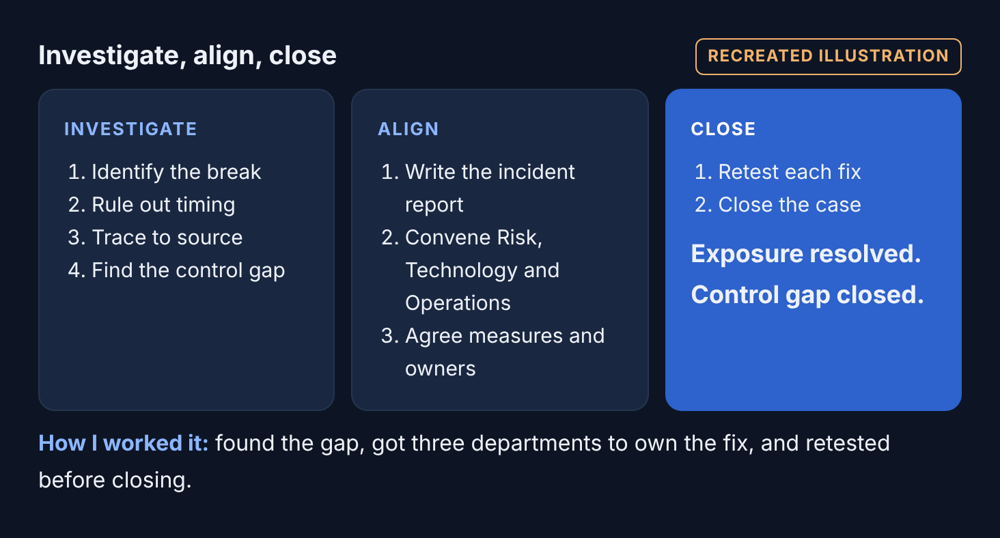
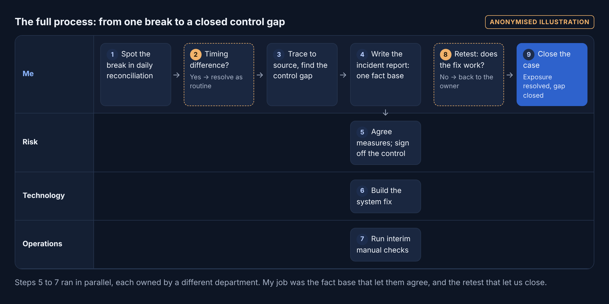
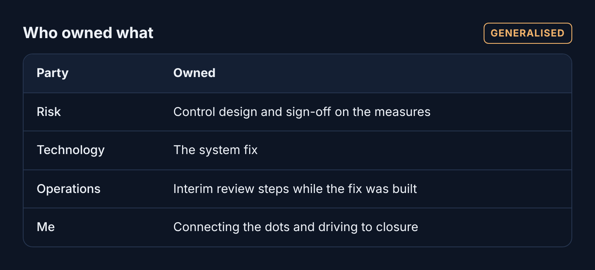

# Collateral Discrepancy Investigation

**Business Analysis Experience · Real experience · Anonymised**  
**Role:** Margin & Collateral Associate

> I caught an eight-figure discrepancy that automated controls had missed, traced it to root cause and drove the fix to closure across three departments.



***How I worked it:** found the gap, got three departments to own the fix, and retested before closing.*

📄 **[Read the full case study on the portfolio website](https://cjsmith-page.github.io/experience/01-collateral-investigation/)**

---

## At a Glance

| | |
|---|---|
| **Problem** | An eight-figure collateral discrepancy had passed through automated controls without being flagged. |
| **What I did** | Investigated it instead of dismissing it, traced it to root cause and brought Risk, Technology and Operations together on who would fix what. |
| **Result** | The exposure was resolved and the control gap closed, with every fix retested before closure. |

## The Situation

Collateral protects a bank if a counterparty can't pay what it owes. If collateral records are wrong, the bank's real exposure is wrong too, and the risk goes unseen until it matters.

My daily work was reconciliation: **80+ accounts a day**, investigating **30–50 breaks a day** across positions, valuations and collateral balances, with a **99% resolution rate**. A break is a mismatch between two records that should agree.

## How I Delivered It

**1. Investigated instead of dismissing**  
During daily reconciliation, something in the pattern didn't look right, even though no control had flagged it.  
*Why:* After reviewing the same accounts every day, I knew what normal looked like. Automated controls only catch what they were designed to catch, so experienced eyes are the second line of defence.

**2. Ruled out the simple explanations**  
Confirmed it wasn't a timing difference before treating it as a real problem.  
*Why:* Escalating an eight-figure issue that turns out to be timing costs credibility. Ruling it out first meant people took the escalation seriously.

**3. Traced it to source and found the control gap**  
Followed the discrepancy back through the data to understand why the control hadn't caught it, not just what the right figure should be.  
*Why:* Correcting one break doesn't stop the next. Finding the gap is what protects the bank going forward.

**4. Built one fact base everyone could work from**  
Wrote an incident report setting out the root cause, the data path and the expected behaviour.  
*Why:* Three departments can't agree on a fix if they're looking at different versions of the problem. One document gave everyone the same starting point.

**5. Aligned three departments on ownership**  
Brought Risk, Technology and Operations together to agree the corrective measures and who owned each one.  
*Why:* Control gaps often sit between teams, so nobody owns them until someone connects the dots. Tracing the cause was one part; getting agreement on who fixed what was the harder part.

**6. Retested every fix before closing**  
Kept an open-actions list and confirmed each fix worked before the case was closed.  
*Why:* A fix that's agreed but never checked is just a plan. Retesting is what makes "closed" true.

## The Call I Made

**Investigate, even though the controls said everything was fine.** It's easy to trust a system that hasn't raised an alert. I trusted the evidence instead, and checked it thoroughly before raising it.

## Process Flows

### The full process: from one break to a closed control gap



*Steps 5 to 7 ran in parallel, each owned by a different department. My job was the fact base that let them agree, and the retest that let us close.*

### Who owned what



## Artifacts

| Artifact | File | Type |
|---|---|---|
| Who owned what | [`artifacts/who-owned-what.md`](artifacts/who-owned-what.md) | Generalised |

## Results

**What happened**

- The eight-figure exposure was resolved and the control gap closed.
- Every fix was retested before the case was closed.
- Across 40+ incident reports I wrote with development teams, break-tracking accuracy improved by 10%.

**What I would measure next**

- Share of breaks caught by automated controls vs. manual review.
- Time from a break occurring to it being detected.
- Repeat breaks with the same root cause.

## Skills Demonstrated

`Root cause analysis` · `Reconciliation` · `Risk & controls` · `Incident reporting` · `Stakeholder alignment` · `Issue management`

## Repository Contents

```
ba-experience-collateral-investigation/
├── README.md        This case study
├── diagrams/        Overview, process flows and swimlanes (PNG)
└── artifacts/       Recreated artifacts (tables and SQL)
```

Employer and client details are anonymised. Diagrams and artifacts are recreated illustrations and contain no company data.

---

### More Business Analysis Experience

[SLA Performance Analysis](https://github.com/CJsmith-page/ba-experience-sla-performance) · [Screening Platform Request Delivery](https://github.com/CJsmith-page/ba-experience-screening-delivery) · [Requirements and Prototype Delivery](https://github.com/CJsmith-page/ba-experience-requirements-delivery)

**Cudjoe John Smith** · Business Analyst · [Portfolio](https://cjsmith-page.github.io) · [GitHub profile](https://github.com/CJsmith-page) · [LinkedIn](https://www.linkedin.com/in/c-john-smith/)
